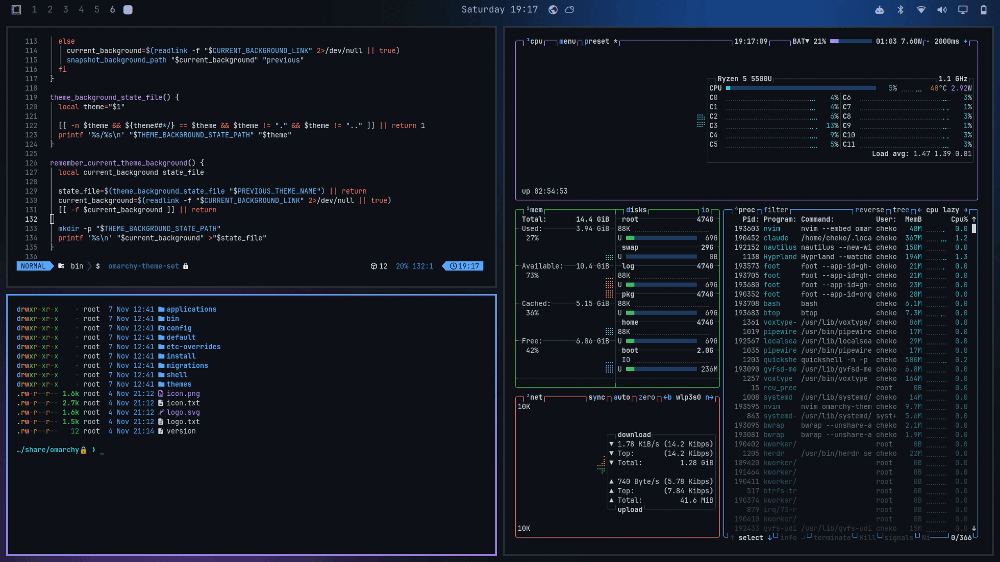

# GitHub Dark for Omarchy

A theme for [Omarchy](https://omarchy.org) built on the official **GitHub Dark Default** (Primer) palette.



## Installation

```bash
omarchy theme install https://github.com/Cheko-00/omarchy-github-dark-theme
```

## What's included

- `colors.toml`: GitHub Dark Default palette (`#0d1117` background, `#58a6ff` accent, GitHub's official ANSI colors). Omarchy generates the colors for terminals, btop, Chromium, Helix, the bar, notifications, the launcher and the lock screen from this file.
- Hyprland border: blue → purple gradient (`#58a6ff` → `#bc8cff`).
- 4 wallpapers: glow, dot grid, contribution graph and solid color.
- Yaru-blue-dark icons and keyboard backlight in `#58a6ff`.
- `unlock.png` / `preview-unlock.png`: Plymouth boot screen in GitHub blue (Menu → Appearance → Unlock).
- `neovim.lua` ([projekt0n/github-nvim-theme](https://github.com/projekt0n/github-nvim-theme)) and `vscode.json` ([GitHub Theme](https://marketplace.visualstudio.com/items?itemName=GitHub.github-vscode-theme)).

> **Note:** for security, `omarchy theme install` drops `neovim.lua` and `vscode.json` from themes installed from a repo, and generates generic equivalents from `colors.toml`. To use the official GitHub theme in Neovim/VS Code, copy the theme by hand instead:
>
> ```bash
> git clone https://github.com/Cheko-00/omarchy-github-dark-theme /tmp/gh-dark
> rm -rf /tmp/gh-dark/.git && mv /tmp/gh-dark ~/.config/omarchy/themes/github-dark
> omarchy theme set github-dark
> ```

## License

MIT
